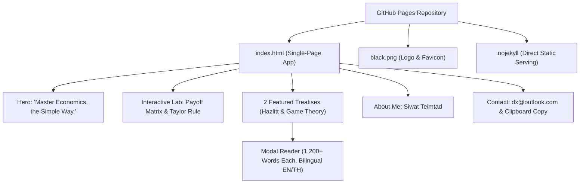

# Implementation Plan: Economist Portfolio Website on GitHub Pages

## Goal Description
Build an economist portfolio website for **Siwat Teimtad** deployed to **GitHub Pages**. The site features a modern dark aesthetic, typography powered by **JetBrains Mono**, an impactful hero section showcasing the quote *"Master Economics, the Simple Way"*, a detailed "About Me" section with contact details, logo integration using `black.png`, and two in-depth 1,000+ word economic projects (*Economics in One Lesson* by Henry Hazlitt and *Game Theory*).

---

## User Review Required

> [!IMPORTANT]
> **Single-Page vs. Dedicated Reading Pages for Projects**:
> Each project requires **at least 1,000 words** of high-density economic analysis. To provide the best reading experience, we propose:
> - **Main landing page (`index.html`)**: Sleek hero, summary cards for projects, about me section, contact, and footer.
> - **Dedicated article pages (`projects/economics-in-one-lesson.html` and `projects/game-theory.html`)**: Long-form, distraction-free reading layout with sticky Table of Contents, footnotes, and math/payoff matrices styling.
>
> *(An alternative is expandable modal overlays or accordion sections on a single page, but dedicated static pages are strongly recommended for SEO, readability, and sharing.)*

> [!NOTE]
> **Logo File (`black.png`)**:
> Please place your `black.png` image file into the project directory (or `assets/images/black.png`). We will configure the navigation bar and favicon to load it directly.

---

## Architecture & Design System

### 1. Typography & Theme
- **Font**: `'JetBrains Mono', monospace` loaded via Google Fonts across all headings, code blocks, cards, and body typography.
- **Color Palette (Modern Dark / Terminal Elegance)**:
  - Deep Dark Base: `#060a12` (slate-950)
  - Card & Surface: `#0b1120` (slate-900) / `#0f172a` (slate-850)
  - Borders: `#1e293b` (slate-800)
  - Accents: Cyan (`#06b6d4`), Emerald (`#10b981`), Amber (`#f59e0b`), Indigo (`#6366f1`)
- **Logo Integration**: `black.png` configured in top navigation bar, about profile avatar, and browser favicon (`<link rel="icon" type="image/png" href="black.png">`) with graceful fallback to monogram badge `ST`.
- **Pure Static Delivery**: Clean self-contained static HTML5 with Tailwind CSS and Font Awesome, 100% compatible with GitHub Pages, zero build errors, and instant loading.



---

## File Structure

```text
├── index.html         # Main portfolio site (Hero, Lab, 2 Projects, About Me, Contact, Modal Reader)
├── black.png          # Logo & Favicon
├── .nojekyll          # Disables Jekyll processing on GitHub Pages
└── plan/
    └── our_plan.md    # Architecture & deployment plan
```

---

## Proposed Changes

We will organize the site under a clean, self-contained project structure ready for GitHub Pages:

```text
portfolio/
├── index.html
├── projects/
│   ├── economics-in-one-lesson.html
│   └── game-theory.html
├── assets/
│   ├── css/
│   │   ├── style.css
│   │   └── article.css
│   ├── js/
│   │   └── main.js
│   └── images/
│       └── black.png
├── README.md
└── .nojekyll
```

---

### Component 1: Core Landing Page (`index.html`)

#### [NEW] `index.html`
- **Navigation Bar**:
  - Brand Logo using `assets/images/black.png` + "Siwat Teimtad".
  - Nav links: *Home*, *Projects*, *Essays*, *About*, *Contact*.
- **Hero Section**:
  - Eyebrow tag: `ECONOMIST & ANALYST`.
  - Main quote in prominent display font: **"Master Economics, the Simple Way."**
  - Subtitle: Distilling complex market dynamics, Austrian school principles, and strategic interactive models into actionable economic intuition.
  - Quick action buttons: `[Explore Projects]` and `[Get in Touch]`.
- **About Me Section**:
  - Name: **Siwat Teimtad**
  - Professional title & bio: Economist focusing on sound monetary economics, market coordination, and applied game theory.
  - Direct contact cards:
    - Email: `dx@outlook.com` (with `mailto:` click-to-email and one-click copy button).
    - GitHub / Academic / Social profile placeholders.
- **Projects / Publications Showcase**:
  - Card 1: *Key Economic Concepts of Economics in One Lesson (Henry Hazlitt, 1946)* — highlighting the central lesson, the unseen effects, and fallacy of the broken window.
  - Card 2: *Foundations & Strategic Dynamics of Game Theory* — Nash equilibrium, Prisoner's dilemma, repeated games, and mechanism design.
  - Word count indicators, reading time badge (~6–8 min each), and direct links to reading view.
- **Footer**:
  - Copyright & minimal dark aesthetic credits.

---

### Component 2: Project 1 Essay (`projects/economics-in-one-lesson.html`)
**Requirement**: Must be at least 1,000 words long.

#### [NEW] `projects/economics-in-one-lesson.html`
Comprehensive essay structured around Henry Hazlitt's 1946 classic:
1. **Introduction & Historical Context (1946 Post-War Era)** (~200 words):
   - The economic climate post-WWII, rise of Keynesian interventions, and Hazlitt's inspiration from Frédéric Bastiat's *Ce qu'on voit et ce qu'on ne voit pas*.
2. **The Single Lesson Formulation** (~150 words):
   - Detailed dissection: *"The art of economics consists in looking not merely at the immediate but at the longer effects of any act or policy; it consists in tracing the consequences of that policy not merely for one group but for all groups."*
3. **The Broken Window Fallacy & Seen vs. Unseen** (~250 words):
   - Glazier fallacy, destruction is not profitable, opportunity cost, diversion of capital and labor from productive enterprise.
4. **Public Works and Taxation** (~200 words):
   - The illusion that government bridge-building creates net employment; examining the uncollected wealth and jobs destroyed through taxation.
5. **Credit, Subsidies, and Price Controls** (~200 words):
   - Distortion of market signals, shortages, supply inelasticity, and misallocation of scarce resources.
6. **Modern Applications for Today's Economists** (~150 words):
   - Quantitative easing, industrial policy, tariff disputes, and why Hazlitt's warning remains urgent.
*Total Word Count Target: ~1,150 – 1,300 words.*

---

### Component 3: Project 2 Essay (`projects/game-theory.html`)
**Requirement**: Must be at least 1,000 words long.

#### [NEW] `projects/game-theory.html`
Rigorous economic deep dive into interactive decision theory:
1. **Introduction: The Mathematics of Strategic Interdependence** (~180 words):
   - Shift from parametric optimization (competitive/monopoly) to strategic interaction (von Neumann & Morgenstern 1944).
2. **Core Taxonomy of Games** (~180 words):
   - Simultaneous vs. sequential, static vs. dynamic, cooperative vs. non-cooperative, complete vs. incomplete information.
3. **The Nash Equilibrium: Concept & Mathematical Formalism** (~220 words):
   - Best response correspondences, fixed-point theorem foundation (Kakutani/Brouwer), strict vs. weak equilibria, and mixed strategy dynamics.
4. **The Canonical Prisoner's Dilemma & Collective Action** (~220 words):
   - Payoff matrix analysis, dominant strategy equilibrium vs. Pareto efficiency, tragedy of the commons, and public goods provision.
5. **Repeated Games & The Evolution of Cooperation** (~200 words):
   - Folk theorems, discount factor $\delta$, tit-for-tat, trigger strategies, and sustaining credibility in long-horizon interactions.
6. **Information Economics, Signaling & Mechanism Design** (~150 words):
   - Akerlof adverse selection, Spence signaling, Vickrey-Clarke-Groves (VCG) mechanisms, and auction design.
*Total Word Count Target: ~1,150 – 1,300 words.*

---

### Component 4: Styling & Scripting

#### [NEW] `assets/css/style.css`
- Google Fonts import: `JetBrains Mono:ital,wght@0,300;0,400;0,500;0,700;1,400`.
- Dark palette CSS variables, typography reset, micro-interactions, smooth scrolling.
- Syntax and matrix formatting for economic payoffs and equations.
- Responsive container, grid layouts, badge components, accessible button styles.

#### [NEW] `assets/js/main.js`
- Mobile hamburger navigation toggle.
- Copy email to clipboard with feedback tooltip (`Copied: dx@outlook.com`).
- Reading progress bar for long essays.
- Smooth link scrolling.

#### [NEW] `.nojekyll`
- Ensures GitHub Pages bypasses Jekyll processing so all folders, assets, and markdown/HTML files are served seamlessly without routing interference.

---

## Step-by-Step GitHub Pages Deployment Guide

Here is the exact procedure to get the site live on GitHub Pages:

### Step 1: Create a GitHub Repository
1. Log into your GitHub account ([github.com](https://github.com)).
2. Click **New Repository**.
3. Choose one of two naming approaches:
   - **User site (recommended)**: Name the repository `<your-username>.github.io` (e.g., `siwatteimtad.github.io`). The site will be published at `https://<your-username>.github.io/`.
   - **Project site**: Name it any name, e.g. `portfolio` or `economics-portfolio`. The site will be published at `https://<your-username>.github.io/portfolio/`.
4. Set repository to **Public**.
5. Initialize without README (we will push our ready-made files).

### Step 2: Initialize Git & Commit Local Files
From the project folder, run:
```bash
git init
git add .
git commit -m "feat: initial economist portfolio website"
git branch -M main
git remote add origin https://github.com/<your-username>/<repo-name>.git
git push -u origin main
```

### Step 3: Enable GitHub Pages in Repository Settings
1. On GitHub, navigate to your repository.
2. Click on the **Settings** tab (top right gear icon).
3. In the left sidebar, click **Pages** (under the "Code and automation" section).
4. Under **Build and deployment**:
   - **Source**: Select `Deploy from a branch`.
   - **Branch**: Select `main` from the dropdown, and leave the folder as `/ (root)`.
   - Click **Save**.
5. GitHub Actions will trigger a deployment workflow (`pages-build-deployment`). Within 1–2 minutes, your live site URL will be displayed at the top of the Pages settings page with a green checkmark:
   > *"Your site is live at https://..."*

---

## Verification Plan

### Automated / Pre-Flight Checks
- [ ] **Word Count Verification**: Count words in `economics-in-one-lesson.html` and `game-theory.html` to guarantee both exceed 1,000 words.
- [ ] **Link Integrity**: Check all internal links (`/index.html`, `/projects/...`, anchors) and email `mailto:dx@outlook.com`.
- [ ] **Asset Validation**: Verify image path `assets/images/black.png` and font loads from Google Fonts.

### Manual Verification
1. Open `index.html` in browser:
   - Inspect JetBrains Mono typography across all headings and paragraphs.
   - Confirm dark background `#090d12` with proper contrast.
   - Check Hero quote: *"Master Economics, the Simple Way."*
   - Check About Me: verify Name `Siwat Teimtad` and Email `dx@outlook.com`.
   - Check Logo: confirm `black.png` renders cleanly.
2. Navigate to Project 1 and Project 2:
   - Confirm rich formatting, reading time badge, and clear structure.
   - Test responsive layout on both desktop and mobile viewport sizes.
